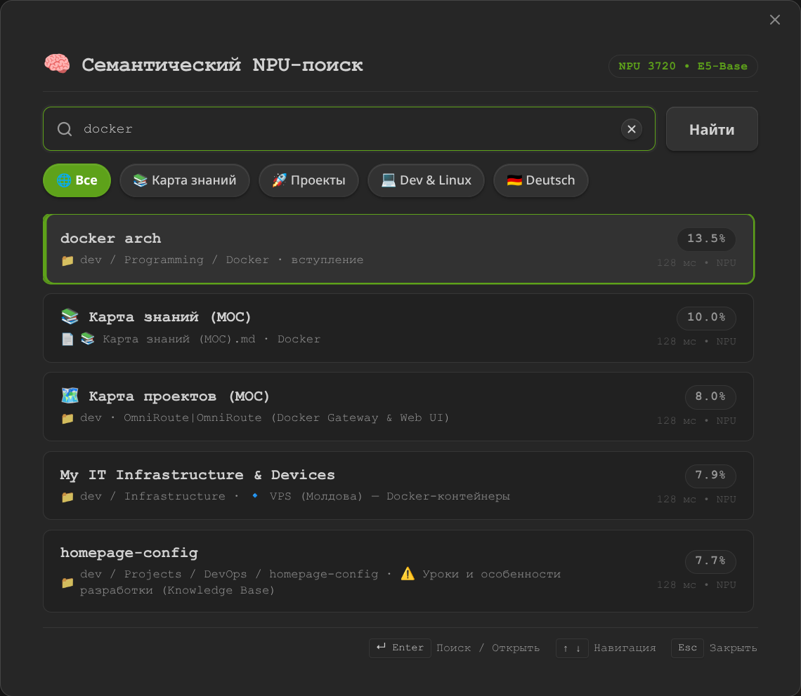

# Intel NPU Semantic Search

[English](README.md) | **Русский**

Семантический (векторный) поиск по заметкам Obsidian. Плагин запускает
[`intfloat/multilingual-e5-base`](https://huggingface.co/intfloat/multilingual-e5-base)
через **OpenVINO** и сам выбирает ускоритель: **Intel NPU → Intel GPU → CPU**.

Работает и на машинах без NPU: плагин переключается на CPU, строит индекс один
раз и дальше обновляет его инкрементально.



> **Плагина нет в каталоге Obsidian.** Ему нужен Python-рантайм и локальная
> модель OpenVINO, а их нельзя упаковать в `main.js`. Установка — из исходников,
> как описано ниже.

---

## Возможности

- Поиск по смыслу, а не по точному совпадению слов.
- Аппаратное ускорение на Intel NPU (AI Boost) с автоматическим fallback на GPU/CPU.
- Категорийные фильтры: все заметки, карты знаний (MOC), проекты, `dev/`, немецкий.
- Инкрементальный индекс: пересчитываются только новые и изменённые заметки.
- Прямое чтение vault с диска (`--vault-path`) — без Obsidian REST API.
- Отдельный CLI для диагностики и полной пересборки индекса.
- Настройки прямо в Obsidian: Python, модель, устройство, top-K.

---

## Требования

- Obsidian Desktop (плагин использует Node.js `child_process`).
- Python **3.10+**.
- Python-пакеты: `openvino`, `tokenizers`, `numpy` (ставятся через `scripts/setup.sh`).
- Модель `Multilingual-E5-Base` в формате OpenVINO IR. INT8-версия
  (≈288 МБ, квантование NNCF weight-only) предпочитается автоматически;
  FP-версия (≈1.1 ГБ) используется как fallback. Квантование —
  `scripts/quantize_int8.py`.
- Для NPU: Meteor Lake / Lunar Lake и драйвер `intel_vpu`. При наличии
  используется Intel GPU. CPU работает всегда.

---

## Установка

Obsidian загружает плагины только из `<vault>/.obsidian/plugins/<id>`, поэтому
клонируйте репозиторий сразу в эту папку.

### 1. Клонировать плагин

```bash
PLUGIN="<vault>/.obsidian/plugins/npu-search"
git clone https://github.com/direktpurpl/obsidian-npu-search.git "$PLUGIN"
```

### 2. Создать Python-окружение

```bash
"$PLUGIN/scripts/setup.sh"
```

Скрипт создаёт venv **вне репозитория**:

```text
~/.local/share/npu-search/venv
```

### 3. Положить модель

Вариант A — скопировать готовую модель с другой машины:

```bash
~/.local/share/npu-search/venv/bin/python \
  "$PLUGIN/scripts/fetch_model.py" --from /path/to/Multilingual-E5-Base
```

Вариант B — скачать и экспортировать из HuggingFace:

```bash
~/.local/share/npu-search/venv/bin/python -m pip install -r "$PLUGIN/requirements-model.txt"
~/.local/share/npu-search/venv/bin/python "$PLUGIN/scripts/fetch_model.py" --download
```

По умолчанию модель ищется здесь:

```text
~/.local/share/npu-search/models/Multilingual-E5-Base
```

Путь можно переопределить через `NPU_MODEL_DIR` или настройку «Модель».

### 4. Включить плагин

`Obsidian → Настройки → Сторонние плагины → Intel NPU Semantic Search`.

Поиск: иконка 🧠 слева, `Ctrl+Alt+F` (поиск), `Ctrl+Alt+D` (сразу с фильтром
«немецкий»). Все хоткеи работают при любой раскладке и переназначаются в
`Настройки → Горячие клавиши`. Либо `Ctrl+P` → «Семантический поиск (NPU)».

---

## Настройки плагина

| Настройка | По умолчанию | Описание |
| :-- | :-- | :-- |
| Python | авто | venv плагина → `~/.local/share/npu-search/venv` → `python3` |
| Модель | `~/.local/share/npu-search/models/Multilingual-E5-Base` | Папка с `tokenizer.json` и OpenVINO IR |
| Устройство | `auto` | `NPU` → `GPU` → `CPU`, либо принудительно |
| Obsidian REST API | `http://127.0.0.1:27123` | Только если vault не читается с диска |
| Результатов | 10 | Сколько карточек показывать |
| Проверить | — | Диагностика окружения |
| Пересобрать | — | Полная переиндексация |

Кнопка «Проверить» показывает версию Python, версию OpenVINO, доступные
устройства, выбранное устройство, наличие модели и число заметок в индексе.

---

## CLI

```bash
PY=~/.local/share/npu-search/venv/bin/python
SCRIPT="<vault>/.obsidian/plugins/npu-search/scripts/npu_vault_search.py"

# Диагностика окружения
$PY $SCRIPT --check

# Поиск
$PY $SCRIPT --query "docker deployment" --top-k 5

# Поиск только по dev/
$PY $SCRIPT --query "systemd timer" --filter dev

# Полная пересборка индекса
$PY $SCRIPT --build-index --vault-path /path/to/your/vault

# Принудительно CPU (например, для отладки)
$PY $SCRIPT --query "backup" --device CPU
```

Переменные окружения:

| Переменная | Назначение |
| :-- | :-- |
| `NPU_MODEL_DIR` | Путь к модели |
| `NPU_INDEX_FILE` | Путь к `.npz`-индексу |
| `NPU_CACHE_DIR` | Кэш компиляции OpenVINO |
| `NPU_DATA_DIR` | Базовый каталог данных (по умолчанию `~/.local/share/npu-search`) |
| `OBSIDIAN_VAULT_PATH` | Корень vault |
| `OBSIDIAN_API_KEY` | Ключ Local REST API |

---

## Структура репозитория

```text
obsidian-npu-search/                       # git-репозиторий (только код)
├── main.js                                # UI и команды Obsidian
├── manifest.json
├── styles.css
├── docs/screenshot.png                    # скриншот для README
├── requirements.txt
├── requirements-model.txt
├── eval/
│   ├── queries.json                       # eval-набор из 40 запросов
│   └── results/                           # метрики (JSON)
└── scripts/
    ├── npu_vault_search.py                # движок поиска
    ├── quantize_int8.py                   # квантование NNCF
    ├── eval_search.py                     # оценка Recall@k / MRR
    ├── fetch_model.py                     # копирование или экспорт модели
    └── setup.sh                           # venv + зависимости

~/.local/share/npu-search/                 # runtime, вне git
├── venv/
├── models/Multilingual-E5-Base/           # FP-модель (fallback)
├── models/Multilingual-E5-Base-INT8/      # INT8 (288 МБ, по умолчанию)
├── indexes/<vault-hash>.npz               # векторный индекс
├── indexes/<vault-hash>.fts.sqlite        # BM25-индекс (FTS5)
└── cache/openvino/
```

Индекс привязан к хэшу пути vault, поэтому несколько хранилищ не конфликтуют.
`models/`, `venv/`, `.cache/`, `*.npz` и `*.fts.sqlite` не попадают в git.

Получить INT8-модель:

```bash
~/.local/share/npu-search/venv/bin/python "$PLUGIN/scripts/quantize_int8.py" --mode weight-only
```

Оценка качества (40 запросов, Recall@1/3/5, MRR):

```bash
~/.local/share/npu-search/venv/bin/python "$PLUGIN/scripts/eval_search.py" \
  --queries "$PLUGIN/eval/queries.json" --out eval/results/my.json \
  --vault-path /path/to/your/vault --label my --device auto --runs 3
```

---

## Производительность

Замеры на INT8-модели с батчевой индексацией, индекс —
**207 заметок / ~1050 секций**.

| Операция | Intel NPU | Только CPU |
| :-- | --: | --: |
| Полный поиск (запрос → выдача) | ~0.8 с | ~1.2 с |
| Загрузка модели на запрос | ~0.6–0.8 с | ~1.1 с |
| Эмбеддинг запроса | ~130 мс | ~90 мс |
| Поиск по индексу (dot product) | < 1 мс | < 1 мс |
| Полная переиндексация (батчи) | ~90 с | ~10 мин |
| Инкрементальное обновление | секунды | десятки секунд |

Референсное железо: колонка NPU — Intel Core Ultra 7 155H (Meteor Lake);
колонка CPU — Intel Core i5-6300U (Skylake, AVX2).

Качество на eval-наборе из 40 запросов:

| Метрика | Значение |
| :-- | --: |
| Recall@1 | 0.875 |
| Recall@3 | 1.000 |
| Recall@5 | 1.000 |
| MRR | 0.929 |

Поиск идёт в отдельном процессе Python (ноль RAM в простое): модель грузится
на время запроса и выгружается. Изменённые заметки переиндексируются в фоне,
поэтому поиск не ждёт пересборку.

---

## Как это работает

1. Плагин вызывает `npu_vault_search.py` с `--query` и `--json`.
2. Скрипт загружает векторный индекс `.npz` и keyword-индекс `.fts.sqlite`.
3. Запрос кодируется моделью `multilingual-e5-base` (`query: ...`).
4. Dense-выдача (косинусное сходство) и BM25-выдача (SQLite FTS5) сливаются
   через RRF; совпадения с заголовком, путём или тегами дают буст, крупные
   «хабовые» заметки штрафуются. Результаты возвращаются в UI.

Заметка режется на секции по заголовкам, каждая секция индексируется отдельно
(до 40 секций на заметку). Поэтому поиск находит нужный раздел длинной заметки,
а не только первые 1200 символов.

Индекс хранит путь заметки, название секции, вектор 768 измерений, `mtime` и
размер файла. При поиске изменённые заметки переиндексируются автоматически,
а в результатах показывается найденная секция.

---

## Решение проблем

**`No module named openvino`**
Запустите `scripts/setup.sh` или укажите правильный Python в настройках плагина.

**`OpenVINO model not found`**
Модель не найдена. Запустите `fetch_model.py --from ...` или `--download`, либо
пропишите путь в настройке «Модель».

**NPU недоступен, выбрался CPU**
Это нормально. Проверьте `--check`: в списке устройств должен быть `NPU`.
На машинах без NPU поведение с CPU — ожидаемое.

**REST API 401 / connection refused**
Плагин и так читает vault с диска. REST нужен только для внешних сценариев.
Ключ берётся из `.obsidian/plugins/obsidian-local-rest-api/data.json`.

**Индекс устарел**
Команда «Пересобрать векторный NPU-индекс заметок» или `--build-index`.
При обычном поиске изменения подхватываются автоматически по `mtime`.

---

## Дорожная карта

План улучшений, замеры и отклонённые варианты: [ROADMAP.ru.md](ROADMAP.ru.md).

---

## Лицензия

MIT
